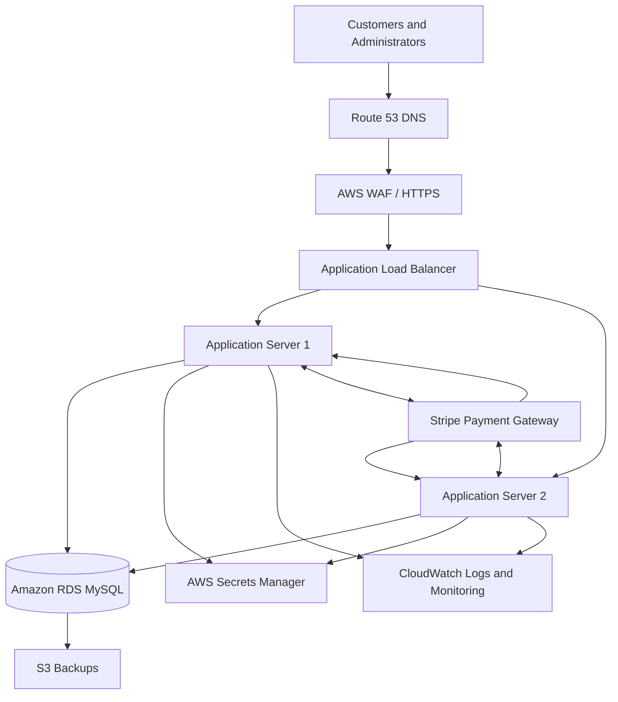

# PayDesk – Technical Proposal and Deployment Guide

This document supplements `PROCESS.md` by covering application setup, database relationships, additional security enhancements, mobile API considerations, deployment approaches, and development tools.

---

## 1. Installation and Testing Instructions

### 1.1 Prerequisites

The following software and services are required:

- PHP 7.3 with the required extensions
- MySQL 8
- Composer
- Nginx or Apache
- Stripe account with test-mode API credentials
- Stripe CLI for local webhook testing

### 1.2 Installation

**Step 1 – Clone the repository**

Clone the project and navigate to the project directory.

**Step 2 – Install Composer dependencies**

```bash
composer install
```

**Step 3 – Create the database**

Create a MySQL database named `paydesk`.

Use the following database configuration:

- Character set: `utf8mb4`
- Collation: `utf8mb4_unicode_ci`

**Step 4 – Import the database**

Import the database schema first, followed by the seed data provided in `database/seed.sql`.

**Step 5 – Configure environment variables**

Copy `.env.example` to `.env` and configure the database credentials and Stripe credentials.

The configuration should include:

- Database host
- Database name
- Database username
- Database password
- Stripe secret key
- Stripe publishable key
- Stripe webhook signing secret

Never commit the actual `.env` file or expose secret credentials in the repository.

**Step 6 – Configure the web server**

Set the web server document root to the project's `public` directory.

Ensure that PHP-FPM is configured to use PHP 7.3 and that the application and writable directories have the appropriate permissions.

**Step 7 – Open the application**

Access the application through the local URL configured in the web server.

### 1.3 Stripe Local Testing

Start the Stripe CLI listener:

```bash
stripe listen --events checkout.session.completed,payment_intent.payment_failed --forward-to localhost:8080/index.php/stripe_webhook
```

Copy the signing secret displayed by Stripe CLI into the local `.env` configuration.

Keep the listener running while testing payment transactions.

Use Stripe test cards and test-mode credentials only.

### 1.4 Testing Procedures

The following scenarios should be tested:

| Area           | Test scenario                                 | Expected result                                         |
| -------------- | --------------------------------------------- | ------------------------------------------------------- |
| Authentication | Valid credentials                             | User can log in                                         |
| Authentication | Invalid credentials                           | Login is rejected                                       |
| Authorization  | Customer opens admin page                     | Access is denied                                        |
| Products       | Admin creates a product                       | Product is saved                                        |
| Cart           | Customer adds multiple products               | Cart reflects selected products                         |
| Orders         | Customer submits a valid order                | Order and invoice are created                           |
| Orders         | Invalid quantity or insufficient stock        | Checkout is rejected                                    |
| Payments       | Successful Stripe payment                     | Payment is marked successful after webhook verification |
| Payments       | Invalid webhook signature                     | Request is rejected                                     |
| Payments       | Duplicate webhook event                       | No duplicate receipt is created                         |
| Invoices       | Customer views own invoice                    | Invoice is displayed                                    |
| Receipts       | Customer views own receipt                    | Receipt is displayed after successful payment           |
| API            | Missing or invalid token                      | Request is rejected                                     |
| API            | Expired or revoked token                      | Request is rejected                                     |
| API            | Customer requests another customer's document | Access is denied                                        |

API requests can be tested using cURL.

---

## 2. Entity Relationship Diagram

The database structure and relationships between the ten application tables are illustrated in the following ER diagram:

[View Entity Relationship Diagram](docs/erd.md)

---

## 3. Further Enhancements to Restrict User Activities Within the Web Application

Beyond the existing role-based authorization, I would introduce additional controls to ensure that sensitive operations can only be performed through their intended application interfaces.

### 3.1 Separate Web and API Responsibilities

Not every operation needs to be exposed through an API.

For example, administrative user management, product management, and other sensitive administrative operations can remain accessible exclusively through the web application.

The mobile API should expose only the resources and actions required by the mobile client.

### 3.2 Server-Side Authorization

The application should enforce permissions at the controller and data-access levels.

Hiding buttons or menu items in the frontend is not sufficient. A user must not be able to execute a restricted action by manually entering a URL or sending a crafted HTTP request.

### 3.3 Session and Request Protection

Additional safeguards include:

- Session ID regeneration after login.
- Secure, HttpOnly, and SameSite cookies.
- CSRF protection for state-changing web requests.
- Session expiration and logout invalidation.
- Validation of HTTP methods for sensitive operations.
- Output escaping to prevent cross-site scripting.

### 3.4 Audit Logging

Maintain an audit trail for important activities, such as:

- Customer account creation and changes.
- Product creation, updates, and deactivation.
- Administrative actions.
- Order status changes.
- Payment status changes.

Audit records should identify the acting user, affected resource, timestamp, and action performed.

### 3.5 Additional Protection for Sensitive Actions

For higher-risk operations, introduce:

- Reauthentication before changing account credentials or performing sensitive administrative actions.
- Multi-factor authentication for administrator accounts.
- Rate limiting for login and other sensitive endpoints.
- Account lockout or temporary throttling after repeated failed login attempts.

These enhancements would provide stronger control over who can perform an operation and through which application interface.

---

## 4. Considerations for a Mobile Application API

The existing API can serve as the foundation for a mobile application, but additional design considerations would be necessary before exposing it to mobile clients.

### 4.1 API Versioning

Use versioned endpoints, such as `/api/v1/`, to support future changes without breaking existing mobile application versions.

### 4.2 Authentication and Token Management

For mobile clients, consider:

- Short-lived access tokens.
- Secure token storage using Android Keystore or iOS Keychain.
- Token revocation and expiration.
- Refresh-token rotation if long-lived sessions are required.
- Rate limiting and monitoring of authentication attempts.

The existing hashed bearer-token approach provides a starting point, but a complete mobile authentication lifecycle would require additional design and testing.

### 4.3 Consistent API Responses

Define a consistent JSON response format for:

- Successful requests.
- Validation errors.
- Authentication failures.
- Authorization failures.
- Missing resources.
- Server errors.

Use appropriate HTTP status codes and avoid returning internal exception details or sensitive database information.

### 4.4 Data Validation and Ownership

All mobile requests must be validated on the server.

The application must not trust user IDs, prices, payment amounts, or ownership information supplied by the mobile client.

Authenticated identity should determine which customer records can be accessed.

### 4.5 Pagination and Performance

For larger datasets, implement:

- Pagination.
- Filtering and sorting.
- Appropriate database indexes.
- Response field selection where appropriate.
- Rate limits to prevent excessive requests.

### 4.6 Stripe Payment Integration

A mobile application should not handle secret Stripe credentials.

The backend should remain responsible for creating payment sessions or payment intents, validating payment results, and processing webhook events.

Sensitive payment confirmation must remain server-side.

### 4.7 CodeIgniter 3 Limitations

CodeIgniter 3 can support REST-style endpoints, but it does not provide all the API-specific capabilities available in more modern frameworks.

Some limitations and considerations include:

- No built-in first-party token authentication lifecycle comparable to newer framework authentication packages.
- API authentication, token expiration, revocation, and authorization need to be implemented and maintained.
- Request validation, API response formatting, rate limiting, and versioning require additional implementation or libraries.
- Its older architecture can make long-term maintenance and integration with modern libraries more challenging.

For this assessment, retaining CodeIgniter 3 is reasonable because it is part of the required technology stack.

For a longer-term production system, I would evaluate upgrading the PHP runtime and migrating to a currently supported framework, such as CodeIgniter 4 or Laravel, after assessing compatibility and migration costs.

---

## 5. Staging and Production Deployment

I would maintain separate staging and production environments to prevent development and testing activities from affecting actual customers or transactions.

### 5.1 Staging Environment

The staging environment should closely resemble production but use separate resources and test credentials.

Recommended configuration:

- Separate application server.
- Separate staging database.
- HTTPS enabled.
- Stripe test-mode credentials.
- Separate environment variables and webhook signing secret.
- Application and PHP error logging enabled.
- Test customer and administrator accounts.

Deployment workflow:

1. Push changes to the development or release branch.
2. Run automated checks and review the changes.
3. Deploy to staging.
4. Run database migration and regression tests.
5. Test Stripe Checkout and webhook behavior.
6. Obtain approval before production deployment.

### 5.2 Production Environment

For production, I would use a cloud-hosted infrastructure with the application and database separated.

Recommended AWS architecture:



### 5.3 Production Components

| Component      | AWS Service                | Purpose                                 |
| -------------- | -------------------------- | --------------------------------------- |
| DNS            | Route 53                   | Domain name management                  |
| Web protection | AWS WAF                    | Web request filtering                   |
| Load balancing | Application Load Balancer  | Distributes incoming traffic            |
| Application    | EC2                        | Runs Nginx, PHP-FPM, and PayDesk        |
| Database       | Amazon RDS for MySQL       | Managed relational database             |
| Secrets        | AWS Secrets Manager        | Stores sensitive credentials            |
| Monitoring     | CloudWatch                 | Logs, metrics, and alerts               |
| Backups        | RDS automated backups / S3 | Database and application backup storage |

The database should not be publicly accessible. It should accept connections only from authorized application servers through private network rules.

For higher availability, application servers can be deployed across multiple Availability Zones, with a Multi-AZ database configuration.

### 5.4 Production Deployment Strategy

I would use a controlled release process:

1. Maintain separate staging and production configurations.
2. Back up the production database before database changes.
3. Deploy the application release to the production environment.
4. Run database migrations using backward-compatible changes where possible.
5. Perform smoke tests on login, product browsing, checkout, and document access.
6. Monitor application errors, PHP-FPM, Nginx, database performance, and Stripe webhook delivery.
7. Roll back the application release if critical issues occur.

For future releases, a rolling or blue-green deployment strategy can reduce downtime.

Database changes should follow an expand-and-contract approach so that old and new application versions can coexist during deployment.

### 5.5 Indicative Cloud Cost

The following are planning estimates, not a final AWS quotation.

| Environment                      | Suggested setup                                                          | Estimated monthly cost |
| -------------------------------- | ------------------------------------------------------------------------ | ---------------------: |
| Staging                          | Small EC2 instance, basic database, storage, and backups                 |             USD 40–100 |
| Production – initial             | EC2 application server, managed MySQL, storage, backups, monitoring      |             USD 70–180 |
| Production – higher availability | Multiple EC2 instances, load balancer, Multi-AZ RDS, backups, monitoring |           USD 200–450+ |

Actual costs depend on the AWS region, instance size, database storage, backup retention, network traffic, load balancer usage, and availability requirements.

For an initial low-traffic deployment, I would start with a single application server and a managed database. As traffic and availability requirements increase, I would introduce multiple application instances and Multi-AZ database deployment.

A detailed estimate should be generated using the AWS Pricing Calculator before implementation.

---

## 6. Additional Tools and Libraries

The following tools and libraries were used or are suitable for the continued development of PayDesk.

| Tool / Library | Purpose                                            |
| -------------- | -------------------------------------------------- |
| CodeIgniter 3  | Backend application framework                      |
| PHP 7.3        | Server-side programming language                   |
| MySQL 8        | Relational database                                |
| Stripe PHP SDK | Stripe Checkout and payment integration            |
| Stripe CLI     | Local webhook forwarding and payment event testing |
| Composer       | PHP dependency management                          |
| Nginx          | Web server and reverse proxy                       |
| PHP-FPM        | PHP request processing                             |
| Bootstrap 5    | Responsive user interface                          |
| JavaScript     | Client-side interactions                           |
| Git            | Version control                                    |
| cURL           | API endpoint testing                               |
| Mermaid        | Entity relationship and architecture diagrams      |

### Potential Future Tools

- **PHPUnit:** Automated unit and integration testing.
- **PHPStan or Psalm:** Static analysis to identify potential code issues.
- **GitHub Actions:** Automated testing and deployment workflows.
- **Sentry:** Application error monitoring.
- **Redis:** Caching and session storage when application traffic increases.
- **Amazon S3:** Secure storage for generated documents and backups.

These tools can be introduced based on actual project requirements rather than adding unnecessary infrastructure at the beginning.

---

## Conclusion

PayDesk is designed as a modular monolithic web application that can be maintained and extended without introducing unnecessary architectural complexity.

The proposed enhancements focus on stronger access control, a more complete mobile API strategy, controlled deployment, monitoring, and future maintainability.

The current CodeIgniter 3 implementation satisfies the assessment's technology requirements, while the proposed modernization path provides room for future growth.
